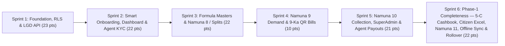

# GPMH-SaaS-.NET — Master Reconciled GitHub Project #2 Backlog (`#5` – `#35`)

> **Repository:** `AvinashRamrajTonde/GPMH-SaaS-.NET` | **Project Board:** [GitHub Project #2](https://github.com/users/AvinashRamrajTonde/projects/2)  
> **Reconciliation Note:** Every Issue ID below maps 1-to-1 with GitHub Project #2 (`#5–#30`) plus the 5 Phase-1 completion issues (`#31–#35`) surfaced during the specification audit. Zero duplicate issue numbers remain.

---

## 1. Architecture Decision Records (`ADR-001` – `ADR-017`)

| ADR | Decision | Summary |
| :--- | :--- | :--- |
| **ADR-001** | ASP.NET Core Clean Architecture | `Domain`, `Application`, `Infrastructure`, `WebAPI` modular monolith (`net9.0` local SDK baseline → `net10.0` target upgrade) |
| **ADR-002** | Strict Dependency Rules | Enforced by `NetArchTest` (`GPMH.ArchitectureTests`) + MediatR CQRS & FluentValidation pipeline |
| **ADR-003** | Shared PostgreSQL + Tenant Discriminator | Shared DB with mandatory `tenant_id` (`uuid`) across operational + child tables |
| **ADR-004** | EF Core Filters + PostgreSQL `FORCE RLS` | Parameterized `SELECT set_config('app.current_tenant_id', @tid, true)` + `NOBYPASSRLS` role `gpmh_app` |
| **ADR-005** | Server-Verified `X-Tenant-ID` | Header treated purely as selector; validated against active `TenantMembership` |
| **ADR-006** | 15m JWT + 7d Rotating Refresh Tokens | Server-side SHA-256 hash store with automatic token-family reuse detection |
| **ADR-007** | Canonical `8 + 1` Role RBAC | `SuperAdmin`, `Gramsevak`, `GP_Admin`, `GP_Operator`, `Surveyor`, `Citizen`, `Auditor`, `Support_Admin`, `Field_Agent` |
| **ADR-008** | Append-Only Immutable Audit Trail | Same-transaction `SaveChangesInterceptor` JSON diffs + `REVOKE UPDATE, DELETE` on `audit_logs` |
| **ADR-009** | PostgreSQL Financial Source of Truth | Acid counters (`ReceiptCounter`, `VoucherCounter`, `PropertyCounter`), `numeric(14,2)` money |
| **ADR-010** | Dual Auth Token Storage | Web: Memory access token + `HttpOnly; Secure; SameSite=Strict` refresh cookie; Mobile: Android Keystore |
| **ADR-011** | Day-One Trilingual UI (`mr`, `hi`, `en`) | `react-i18next` + Noto Sans Devanagari typography |
| **ADR-012** | Agent Actor Model (`MOD-AGT`) | Isolated `AgentId` RLS policies + private encrypted KYC documents |
| **ADR-013** | Dual-Rate Commission & Pro-Rata | Separate New GP vs Renewal commission rates, snapshot on transaction, pro-rata settlement |
| **ADR-014** | Offline Tax Camp Sync (`Namuna 6` Ranges) | Pre-allocated per-device Receipt Book ranges + idempotent `OperationId` replay (no LWW on money) |
| **ADR-015** | India DPDP Act 2023 & Aadhaar Security | AEAD encrypted Aadhaar + blind index lookup + `XXXX-XXXX-1234` masking + pre-signed KYC URLs |
| **ADR-016** | Canonical Tax Formula (`TaxDivisor = 1000`) | `(Land + Depreciated Building) * Weight * Rate / 1000`, `Age <= AgeTo`, captured default seeds |
| **ADR-017** | QuestPDF Server-Side A4 Landscape | Authoritative QuestPDF vector PDFs with Noto Sans Devanagari (zero Puppeteer) |

---

## 2. Reconciled 6-Week / 6-Sprint Roadmap (`120 Points`)

---

## 3. Authoritative Backlog Mapping (`#5` – `#35`)

### Sprint 1 — Foundation, Multi-Tenancy, Audit & LGD (`23 Points`)
| Issue | Epic | Title | Pts | Role | Status / Scope |
| :---: | :--- | :--- | :---: | :--- | :--- |
| **#5** | `00-Foundation` | Clean Architecture Solution Scaffold (.NET + React 19.3 + i18n) | 5 | Fullstack | **Scaffolded & Compiling in this repo** |
| **#6** | `00-Foundation` | Multi-Tenant Schema & Parameterized PostgreSQL `FORCE RLS` | 5 | Backend | `TenantMembership` validation + `set_config` + Cross-tenant tests |
| **#7** | `00-Foundation` | Identity, 8+1 Role RBAC & Rotating Refresh Tokens | 3 | Backend | 15m JWT + 7d reuse-detected cookie rotation |
| **#8** | `01-External-LGD-API` | Expose RESTful Public LGD Directory Endpoints | 3 | Backend | **Live (`https://api.grampanchayatmh.in/api/v1/`) + Hardened here** |
| **#9** | `01-External-LGD-API` | SQLite Indexing, Search Safety & Hosting Hardening | 2 | DevOps | `15/15` automated tests passing in `external-api-proj/` |
| **#24** | `00-Foundation` | Immutable Audit Trail & Field-Level JSON Diff Tracking | 5 | Backend | Same-tx interceptor + `REVOKE UPDATE, DELETE` |

### Sprint 2 — Smart Onboarding, Executive Hub & Agent Gate (`22 Points`)
| Issue | Epic | Title | Pts | Role | Template Reference |
| :---: | :--- | :--- | :---: | :--- | :--- |
| **#10** | `02-Tenant-Onboarding` | Dual-Mode LGD Discovery Frontend UI (Code & Cascading Dropdowns) | 3 | Frontend | `21_gp_onboarding_wizard.html` |
| **#11** | `02-Tenant-Onboarding` | Auto-Fill Mapping & "Allow Edits" Override Badge Engine | 5 | Fullstack | `21_gp_onboarding_wizard.html` |
| **#12** | `02-Tenant-Onboarding` | Statutory Bank Accounts (Dynamic UPI Config) & Default Formula Seeding | 3 | Fullstack | `16_formula_settings_masters.html` |
| **#25** | `10-Village-Dashboard` | Village Executive Dashboard & Quick Actions Hub | 5 | Frontend | `02_dashboard.html` |
| **#26** | `02-Tenant-Onboarding` | SuperAdmin Direct GP Tenant Provisioning Portal | 3 | Fullstack | `superadmin_add_gp.html` |
| **#30** | `09-Agent-Portal` | Field Agent Self-Registration & Status-Gated Login | 3 | Fullstack | `agent_register.html`, `agent_login.html` |

### Sprint 3 — Formula Masters & Namuna 8 / Sub-Division (`22 Points`)
| Issue | Epic | Title | Pts | Role | Template / Spec Reference |
| :---: | :--- | :--- | :---: | :--- | :--- |
| **#13** | `03-Formula-Masters` | 12 Construction Types, Land Annual Rates & Ready Reckoner Master | 3 | Fullstack | `statutory-master-seeds.json` |
| **#14** | `03-Formula-Masters` | 9 Depreciation Slabs (`Age<=To`), Usage `(1.0/1.2/1.25)`, Slabs & Water | 3 | Backend | `canonical-tax-specification.md` |
| **#15** | `04-Namuna-8-Assessment` | Multi-Floor Property Registration & Real-Time `TaxDivisor=1000` Calculator | 5 | Fullstack | `04_namuna_8_add_registration.html` |
| **#16** | `04-Namuna-8-Assessment` | Statutory 29-Column Namuna 8 QuestPDF (A4 Landscape) & Property Print | 3 | Backend/FE | `08_namuna_8_statutory_print_extract.html` |
| **#17** | `04-Namuna-8-Assessment` | Property Mutation & Ownership Transfer Register | 3 | Fullstack | `09_namuna_8_mutation_register.html` |
| **#27** | `04-Namuna-8-Assessment` | Property Sub-Division & Multi-Heir Partition Wizard (Zero-Dues & ±0.1%) | 5 | Fullstack | `10b_namuna_8_mutation_split.html` |

### Sprint 4 — Namuna 9 Demand & 9-Ka QR Demand Bills (`10 Points`)
| Issue | Epic | Title | Pts | Role | Template Reference |
| :---: | :--- | :--- | :---: | :--- | :--- |
| **#18** | `05-Namuna-9-Demand` | 2-Page Spread Demand Register, Arrears Rollover, 10% Rebate & Formats A/B/C | 5 | Fullstack | `11_namuna_9_demand_register.html`, `namuna9_register_print.html` |
| **#19** | `06-Namuna-9Ka-Bills` | Batch Demand Bills QuestPDF (2-in-1 A4 Landscape / A5) + 15-Day Notice + UPI QR | 5 | Fullstack | `13_namuna_9ka_bill_print_template.html` |

### Sprint 5 — Namuna 10 Collection, SuperAdmin HQ & Agent Commissions (`21 Points`)
| Issue | Epic | Title | Pts | Role | Template Reference |
| :---: | :--- | :--- | :---: | :--- | :--- |
| **#20** | `07-Namuna-10-Receipts` | Multi-Tax POS Collection Modal & Strict FIFO Allocation Engine | 5 | Fullstack | `15_namuna_10_collection_modal.html` |
| **#21** | `07-Namuna-10-Receipts` | Dual A4 Landscape QuestPDF Receipt (`138/8/138mm`) & Cancellation Reversal | 3 | Fullstack | `17_namuna_10_dual_receipt_print.html` |
| **#22** | `08-SuperAdmin-HQ` | Statewide Aggregated KPI Dashboard & 15-Min Audited Support Impersonation | 3 | Fullstack | `22_superadmin_dashboard.html` |
| **#23** | `08-SuperAdmin-HQ` | Subscription Payment Approval, UTR Check & 365-Day License Lifecycle | 2 | Fullstack | `22_superadmin_dashboard.html` |
| **#28** | `09-Agent-Portal` | Agent Workspace Dashboard, Referral Link & Commission Ledger | 5 | Fullstack | `agent_dashboard.html` |
| **#29** | `08-SuperAdmin-HQ` | SuperAdmin Agent Governance, KYC Approvals & Payout Disbursements | 3 | Fullstack | `superadmin_agents.html` |

### Sprint 6 — Phase-1 Completeness & Production Hardening (`22 Points`)
| Issue | Epic | Title | Pts | Role | Why Added in Audit |
| :---: | :--- | :--- | :---: | :--- | :--- |
| **#31** | `07-Namuna-10-Receipts` | Downstream `Namuna 5-C` Cash Book & `Namuna 6` Auto-Credit / Reversal Sync | 5 | Backend | Required by `new_requirements.md §14` & `INT-001` |
| **#32** | `11-Citizens-Migration` | Citizen 360° Master, Aadhaar Masking/Encryption & 26-Col Excel Bulk Import | 5 | Fullstack | Enables onboarding existing 500–5,000 properties/GP |
| **#33** | `04-Namuna-8-Assessment` | `Namuna 11` Misc Receipt Dual Print & Smart QR Nameplate (`19_digital_nameplate_qr_print.html`) | 3 | Fullstack | Completes promised `#16`/template Phase-1 deliverables |
| **#34** | `12-Offline-Public-Verify` | Public Extract Verification Portal (`/verify/extract/{token}`) & Offline `Namuna 6` Sync Queue | 5 | Fullstack | Resolves offline tax camp requirement & QR verify URL |
| **#35** | `05-Namuna-9-Demand` | Annual FY Rollover Batch Job, Period Locking & UPI UTR Reconciliation Report | 4 | Backend | Safe year-end rollover across 27,931 GPs |

