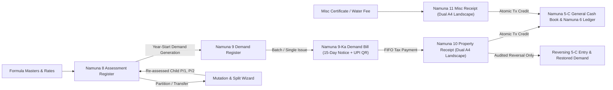

# Statutory Namuna 8, 9, 9-Ka, 10, 11 & 5-C/6 Accounting Lifecycle

> **Statutory Authority:** Maharashtra Village Panchayats Act, 1958 (Sections 124–129) & Maharashtra Village Panchayats Accounts Code, 2011.

---

## 1. End-to-End Fiscal & Accounting Flow

---

## 2. Statutory Register Responsibilities

| Register | Purpose | Authoritative Format | Key Domain Rules |
| :--- | :--- | :--- | :--- |
| **Namuna 8** | Quinquennial Assessment List of Buildings & Lands | QuestPDF **A4 Landscape (29 Columns)** | Multi-floor capital value calculation (`TaxDivisor = 1000`, `Age <= AgeTo`); QR verification token; tripartite signature block (`Gramsevak`, `Sarpanch`, `Clerk`). |
| **Namuna 8 Mutation / Split** | Ownership Transfer & Heir Sub-Division (`10b`) | Register + Split Decree Summary | Strict **Zero-Dues Gate** (`PendingDues == 0`) & **±0.1% Area Conservation**; creates `P/1, P/2` children via `parent_property_id`. |
| **Namuna 9** | Annual Tax Demand & Recovery Register | QuestPDF **A4 Landscape 2-Page Spread** (Formats A / B / C) | Aggregates prior arrears + current demand + rebates/penalties across tax heads; locks historical FY upon rollover. |
| **Namuna 9-Ka** | Statutory Demand Bill & 15-Day Notice | QuestPDF **A5** or **2-in-1 A4 Landscape** | Prints itemized arrears/current dues, **15-day** payment notice window, **10%** early rebate / late penalty notice, and NPCI `upi://pay?pa=...` QR. |
| **Namuna 10** | Property Tax Official Receipt | QuestPDF **Dual A4 Landscape (`138 / 8 / 138mm`)** | Gap-free monotonic `ReceiptCounter`; strict **FIFO allocation** (`Notice/Penalty -> Oldest Arrears -> Current Year -> Excess Credit`); immutable after issuance. |
| **Namuna 11** | Miscellaneous Receipt (Birth/Death/No-Dues/Fee) | QuestPDF **Dual A4 Landscape (`138 / 8 / 138mm`)** | Gap-free per-tenant receipt series; atomic posting to `Namuna 5-C` Cash Book. |
| **Namuna 5-C / 6** | General Cash Book & Classified Abstract | Daily Cash Book Ledger | Same-transaction posting alongside every `Namuna 10` / `Namuna 11` receipt or approved cancellation reversal. |

